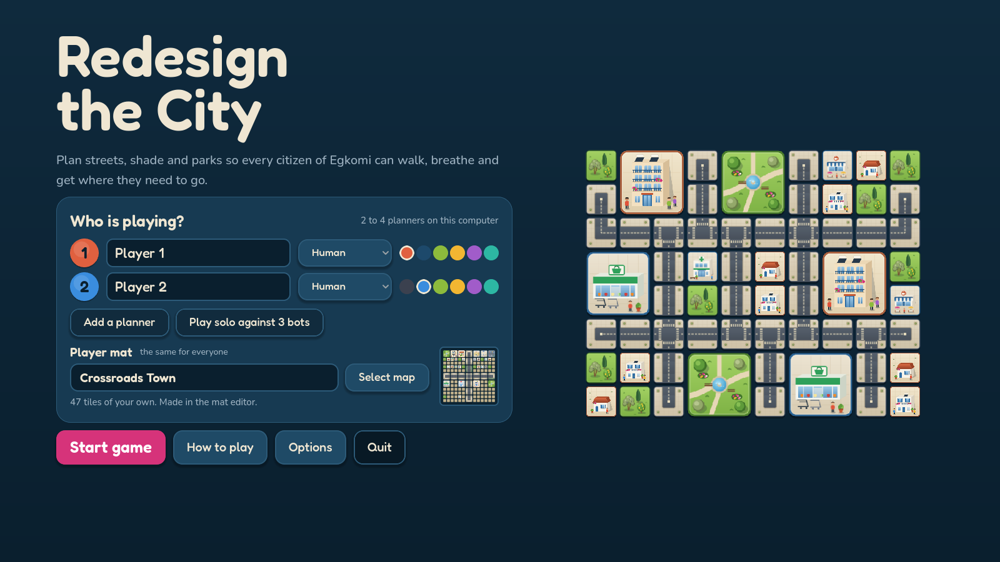
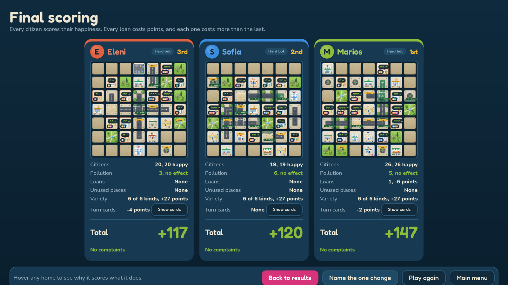
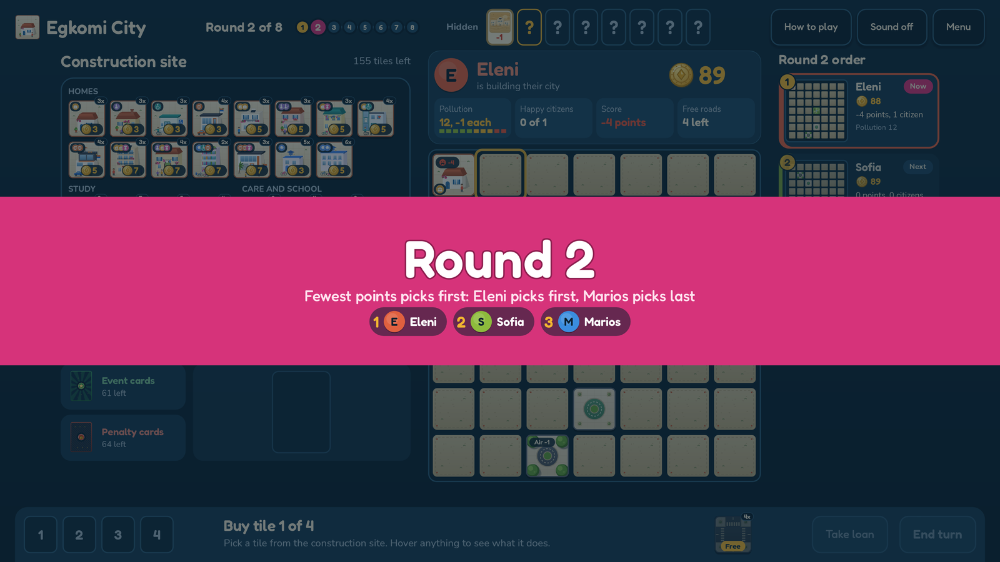
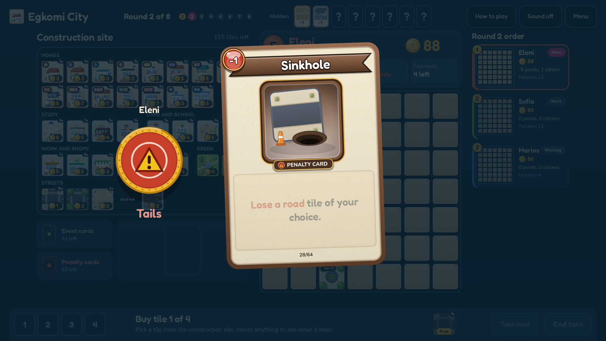
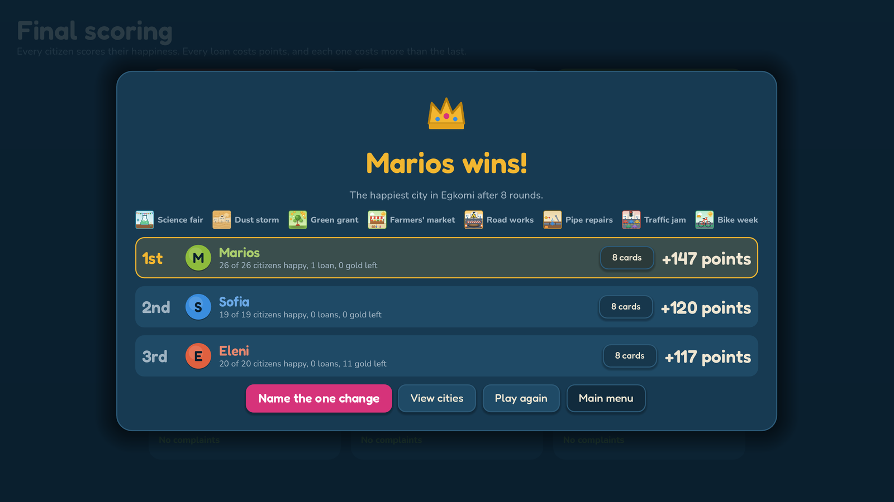
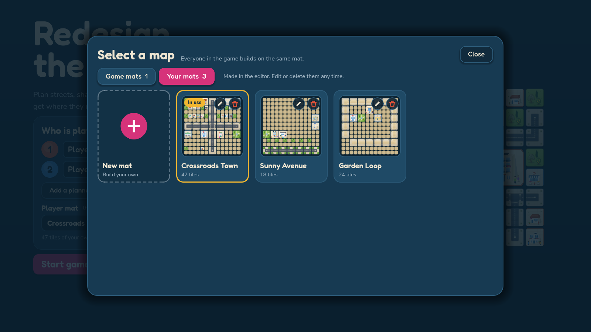
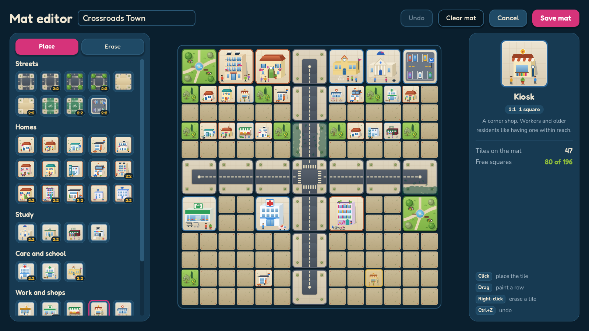

  

<h1 align="center">Redesign the City</h1>

  A city-building board game about streets, shade and green space in Egkomi, Nicosia. 
  1 to 4 players on one computer.

  <a href="https://github.com/11samy02/redesign-the-city/releases/latest"><b>Download 3.0 for Windows</b></a>

---

## How it plays

Every round, each planner buys 4 tiles from a shared construction site and builds them on their own 14x14 city. Tiles are 1:1 (one square: small homes, kiosks, trees, roads) or 2:2 (four squares: large homes, university, hospital, park). Homes bring citizens. Everything else keeps them happy.

- **Six kinds of citizen**: students, workers, children, older residents, residents with a disability and expats. Each one needs two things nearby (a university and a library, a school and a park, a clinic and a market...), likes a few others, and dislikes one.
- **Roads** link homes to the places their citizens need. A long walk with no shade heats them up.
- **Parks and trees** cheer up neighbours, clean the air and shade the roads next to them.
- **Your own start mats**: build a mat in the editor, with streets and buildings that are already there when the game starts, and pick it on the title screen.
- **Pollution** starts high and drags everyone's mood down until you plant green.
- **Pricier is better**: a hospital or a supermarket does the same job as a clinic or a market, and also gives +1 happiness to every citizen it serves.
- **Gold** is tight. A loan helps now but costs more points with every one you take.
- **Cards**: every turn a coin flip picks an event or a penalty card. Hidden circumstance cards, like a heatwave or a flu wave, are revealed round by round and change the rules for everyone.

After 8 rounds every citizen scores their happiness, from -5 to +5. A mix of happy citizens earns a variety bonus. The happiest city wins.

  

<table>
  <tr>
    <td></td>
    <td></td>
  </tr>
  <tr>
    <td colspan="2"></td>
  </tr>
</table>

## Build your own mat

Press **Select map** on the title screen to choose where everyone builds. **Game mats** come with the game. **Your mats** are the ones you made: the first card, **New mat**, opens the mat editor. Picking a card switches the mat at once and the window stays open, so you can try a few.

  

The editor has no gold limits. Pick any tile on the left, including 1:1 and big 2:2 streets, and click the board to place it. Drag to paint a row, right-click to erase, Ctrl+Z to undo. Name the mat and save it. Tiles you place stay on every planner's mat from the first turn and cannot be replaced, so leave room (at least 80 free squares) to build around them. Saved mats can be edited or deleted from the picker.

  

## Features

- Pass-and-play for 2 to 4 people, or play solo against Easy, Medium and Hard bots that plan whole cities
- A mat editor and a map picker: build, name, edit and delete your own start mats
- 64 event and penalty cards, plus 24 hidden circumstances
- Hover any tile to see exactly what it does in your city right now
- Points preview before you build, with live routes, shade and citizen moods
- "Name the one change" at the end: each planner picks what would have added the most points
- Full mouse or keyboard control
- Options for fullscreen, volume, bot speed and animation speed

## Play

1. Download the zip from the [latest release](https://github.com/11samy02/redesign-the-city/releases/latest).
2. Unzip it and run `RedesignTheCity.exe`.

Windows 10 or 11, 64-bit. Nothing to install. The **How to play** screen in the game explains every rule.

## Build it yourself

The game is made with **Godot 4.7** (GDScript, no plugins). Install [Godot 4.7](https://godotengine.org/download), open this folder as a project and press F5 (main scene: `scenes/title.tscn`). Export for Windows: Project > Export > "Windows Desktop".

## Tests and tools

All commands run from the project root.

| What | Command |
| --- | --- |
| Unit tests | `godot --headless --path . --script res://tests/run_tests.gd` |
| Script syntax check | `godot --headless --path . --script res://tests/check_scripts.gd` |
| Bot economy and balance simulation | `godot --headless --path . --script res://tests/simulate_balance.gd -- --games=6 --level=2` |
| Real-click UI probes | `godot --path . --resolution 1600x900 -- --probe=click\|cards\|popups\|matedit` |
| Visual playtest with screenshots | `godot --path . --resolution 1600x900 -- --tour=<dir> --players=4 --bot=greedy` |

`tools/` holds the Python and GDScript used to generate tile and card art and the print-and-play sheets. `godot --path . --script res://tools/export_a4.gd` writes the A4 pages to `print_export/a4`: 2:2 tiles 4 cm and 1:1 tiles 2 cm sharing pages, the cards, the pollution bars with their chips and the planner's guide (two to a page).

## Code map

| Path | Contents |
| --- | --- |
| `scripts/core/` | Rules with no UI: `grid` (the 14x14 squares and tile footprints), `game_state`, `scoring`, `tile_defs`, `roles`, `card_defs`, `card_effects`, `circumstance_defs`, `mat_library`, `bot`, `bot_planner` |
| `scripts/resources/`, `resources/mats/` | `PlayerMatPreset` and `PresetTile` resources, the format of a prefixed mat (custom mats: `scripts/core/custom_mats.gd`, editor and map picker: `scripts/ui/mat_editor.gd`, `mat_picker.gd`) |
| `scripts/game/`, `scripts/final/`, `scripts/ui/` | Board screen, final scoring screen and shared widgets |
| `scenes/` | `title`, `game`, `final` |
| `assets/` | Tile, card, UI and font art (SVG) |
| `tests/` | Unit tests (`test_*.gd`) and probes |
| `docs/` | Design notes and plans |

When you change a scoring or tile rule, re-run the unit tests and the balance simulation, because the bot planner is tuned to the score range.

Fonts: Fredoka and Nunito, SIL Open Font License.
